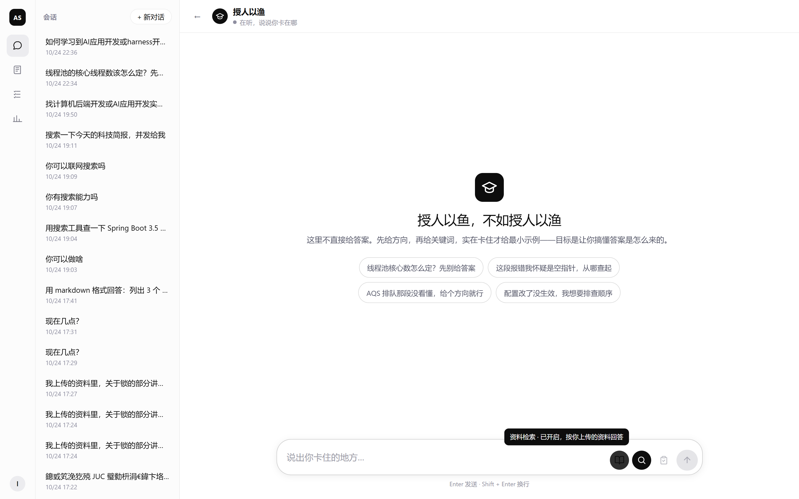
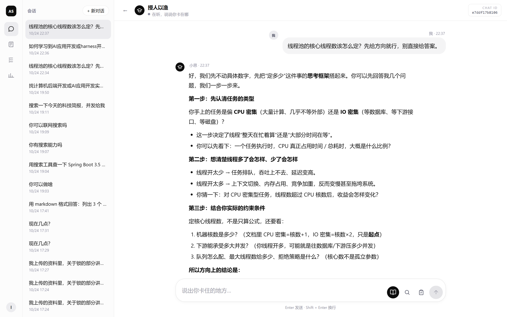
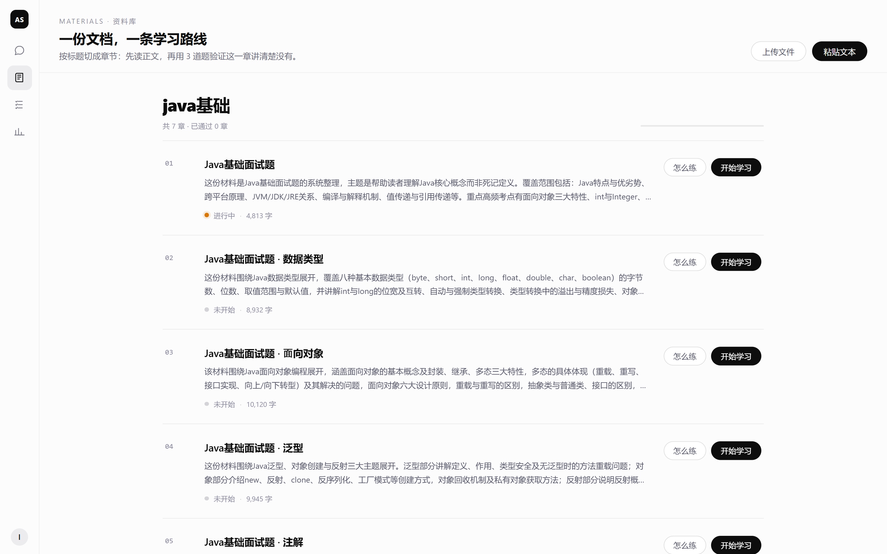
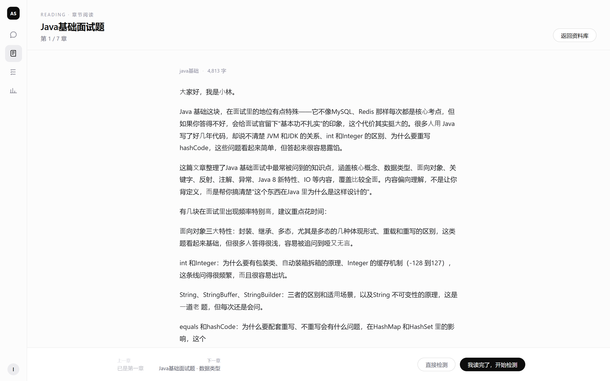
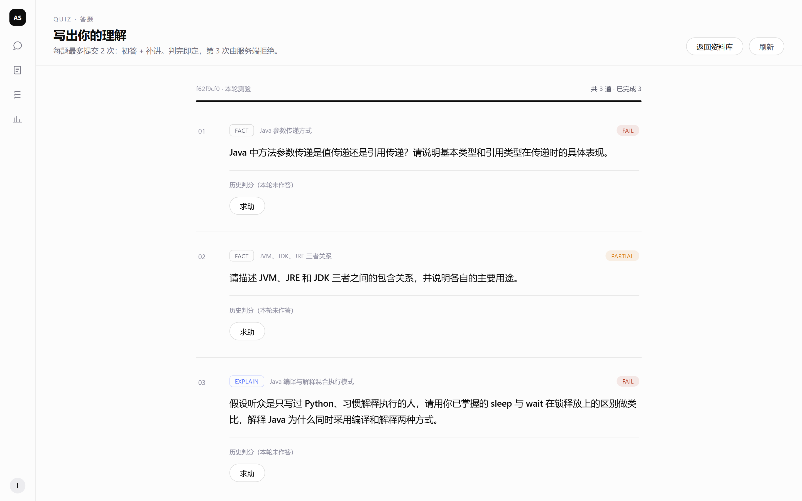
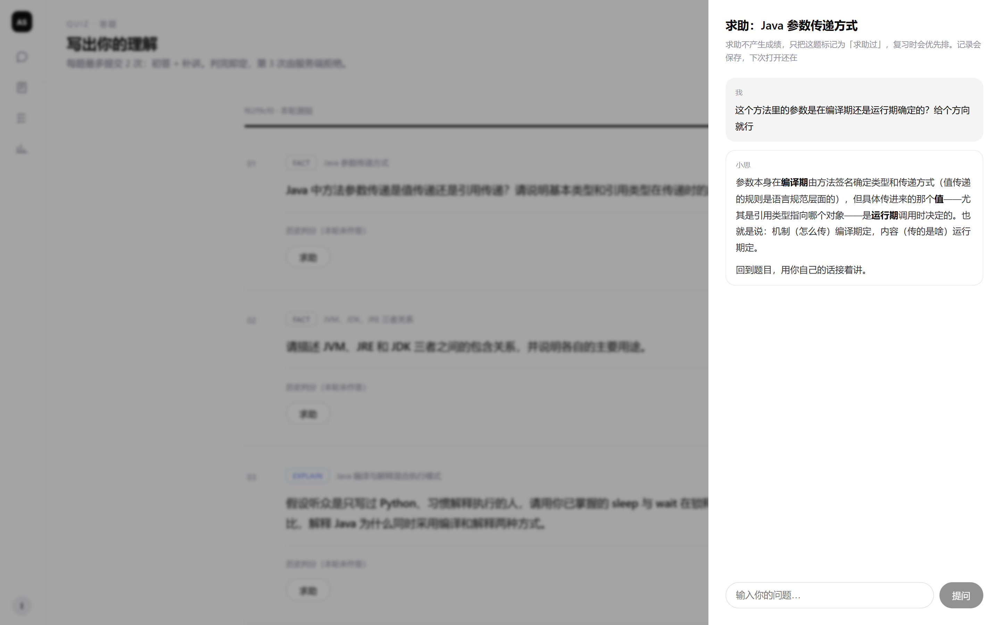
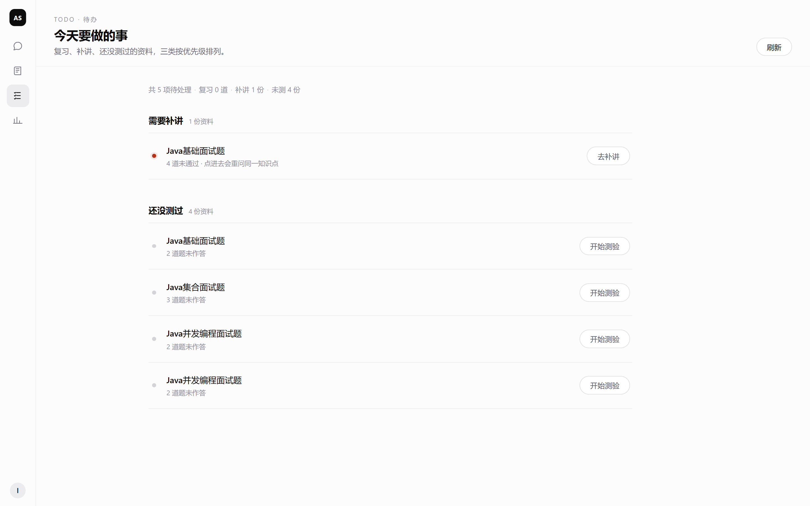

# ai-agent-study



一个**不直接给答案**的学习系统，有两条并行链路：

| 链路 | 入口 | 做什么 |
|---|---|---|
| **A · 自由提问** | `/guide` | 直接把问题丢进去。AI 按「方向 → 关键词 → 伪代码 → 最小示例 → 完整答案」分级回答，不一次性倒给你。可开资料检索（只查自己的资料）、可开联网（网页搜索 + 抓网页）；当前时间始终可用。不传任何资料也能用。 |
| **B · 费曼 harness** | `/materials` → `/quiz` → `/todo` | 把讲义、笔记、博客正文传进去，按标题切章，逐章阅读 → 出题 → 你写 → AI 判 → 卡住的追问 → 到期复习。 |

两条链路不是孤立的：**「把这轮做成题」**把一次自由对话直接转成 3 道题，落到链路 B；**「怎么练」**按某一章生成练习方案，落进可继续追问的 `PRACTICE` 会话，回流到链路 A。

```
自由提问  /guide  ──► POST /ai/chat/stream（SSE）
                    ├─ 资料检索 ──► pgvector 检索自己的资料
                    ├─ 联网     ──► 搜索 / 抓网页
                    └─ 做成题   ──┐
资料驱动  /materials ──► 切章 ──► 出题 ──► 作答 ──► 判分 ──► 复习排期
                              └─ 求助 / 跳过              └─► /todo → /review/start
```

Java 21 · Spring Boot 3.4 · Spring AI 1.1 · PostgreSQL + pgvector · Vue 3 + Vite

---

## 一、为什么这么设计

### 自由提问那一侧的毛病

通用 AI 答得又快又好，用久了会出现一种错觉：看它推一遍，心里点头，关掉对话框却一句都讲不出来。

问题不在答案质量，而在**它把最费劲的那一步替你走了**。学一个东西最值劲的动作是把话从自己嘴里说出来，说的时候才会发现哪里其实没懂。

所以链路 A 把回答改成逐级递进：先给方向，再给关键词，再给伪代码或最小示例，实在卡住才给完整答案。你可以随时叫停——「给个方向就行」是一句有效指令。

### 资料驱动那一侧的理论

费曼学习法只有四步：挑一个概念，用最朴素的话讲给外行听；讲到卡壳的地方，那就是没懂的地方；回去翻原文补上；再讲一遍。

四步谁都会，难的是没人盯——讲给谁听、谁来判你讲清楚没有、上次卡在哪还记不记得。这三样只要缺一件，第四步永远走不到。

训练大模型时有个词叫 **harness**：光有模型不够，还得有一套东西专门喂题、跑结果、判分、记账，模型才知道自己错在哪。学习同理——光有资料和脑子不够，缺的是一套把「讲、判、补、记」跑起来的架子。

| 费曼步骤 | 链路 B 里的机制 |
|---|---|
| 挑概念 | 讲义按标题切章，逐章出 3 道题（至少 1 道解释题） |
| 讲出来 | 答题框自己写，AI 不代笔；题面不把答案写在脸上 |
| 发现缺口 | 判 `PASS` / `PARTIAL` / `FAIL`，判 `PARTIAL` 只指出缺哪一环，不给原文定义与数值 |
| 回原文补 | 「补讲一次」+ 复习排期（1 / 3 / 7 天），到期题与跨资料交错题混排 |
| 再讲一遍 | 复习轮次重问同一知识点；求助过的题在复习队列里优先 |

两条链路共享同一套回答策略：**能指出你漏了哪一步，不能替你说出那一步**。

---

## 二、链路 A · 自由提问

### 对话

- SSE 流式输出，前端用 `fetch` + `ReadableStream` 解析（`EventSource` 只支持 GET，带不了 JSON 请求体）
- AI 回答走 markdown 渲染（marked + DOMPurify），表格、代码块、列表、链接正常
- 左侧栏列出历史会话，点开即续；会话标题取首条 USER 消息前 50 字
- 会话按用户隔离；出题与复习产生的会话不会混进这条列表

### 三个开关（输入框左侧）

| 图标 | 开关 | 行为 |
|---|---|---|
| 书本 | 资料检索 | 开启后走 RAG，`filterExpression` 按 `userId` 过滤，只检索自己的资料，`topK(5)` |
| 放大镜 | 联网 | 开启后挂网页搜索 + 抓网页工具；会外发请求、消耗搜索额度，默认关闭 |
| 剪贴板 | 把这轮做成题 | 把当前对话压缩成 3 道题，跳到测验页 |

当前时间工具**不受开关控制，每轮都挂**：不联网、无副作用，问「现在几点」不该先去点按钮。



上图这一轮问的是「线程池核心线程数怎么定？先给方向就行，别直接给答案」。回答没有给出公式，先确认任务类型，再列出约束条件，最后才问回读者——这就是「分级回答」的实际样子。

### 工具

| 分类 | 工具 | 挂载条件 |
|---|---|---|
| 只读 | 查当前时间 | 始终 |
| 只读 | 网页搜索、抓取网页 | 「联网」开启 |
| 其余本地工具 | 终端、写文件、下载、PDF 等 | 只在 `LiManus`（ReAct 智能体）侧挂载，不对聊天开放 |

聊天侧只挂只读工具，是因为带副作用的工具不适合用一个开关就放开给对话。

---

## 三、链路 B · 费曼 harness

### 资料与阅读

- 粘贴文本或上传 `.md` / `.txt` / `.pdf`（单文件 ≤ 5MB，正文 ≤ 20 万字）
- 按标题切章，单文档最多 30 章；单块超 12000 字时按句子边界继续切
- 每章自动生成摘要；资料库按文档分组，章节标三态（未测 / 进行中 / 已通过）
- 阅读页给正文、上/下一章与去测验入口

<table>
<tr>
<td width="60%"><br><sub>资料库：一份文档一条学习路线，逐章标状态</sub></td>
<td width="40%"><br><sub>阅读页：读完直接进测验</sub></td>
</tr>
</table>

### 出题与判分

- 每章 3 道题，至少 1 道 `EXPLAIN`；`FACT` 考事实，`EXPLAIN` 考「讲清楚」
- 题面只点明考察对象，禁止把结论写进题面。例：不问「偏向锁怎么升到轻量级锁」，而问「对象刚创建时锁是什么状态」
- 判三档 `PASS` / `PARTIAL` / `FAIL`；`gaps` 只描述缺失环节，不给材料里的数值、公式、术语定义
- 单题最多提交 2 次（初答 + 补讲），第 3 次返回 400，提示回原文重看
- 上次判 `FAIL` / `PARTIAL` 的题，下一轮出题时重问 1 道 + 新出 2 道
- **幂等**：同一章还有未作答且未跳过的题时，`POST /quiz/generate` 直接返回原会话，中途退出再进不覆盖题面与判分

<table>
<tr>
<td width="62%"><br><sub>题面只点明考察对象，右上角是判分结论</sub></td>
<td width="38%"><br><sub>求助记录落库，关掉再开、刷新都还在</sub></td>
</tr>
</table>

### 求助与跳过

- 求助不限次数，每次问答落 `t_help_turn`，关抽屉、刷新页面都能回放
- 求助过的题打 `help_used` 标记，复习队列里优先排
- 跳过不是作答、不产生成绩，只置 `skipped`；有复习排期的题跳过后排期推后 1 天

### 复习与进度

- 复习间隔按结果决定：`PASS` 走 1 → 3 → 7 天（走完置 `DONE`），`PARTIAL` 3 天，`FAIL` 次日
- 复习轮次 = 到期题 + 交错题（来自另一份资料），最多 3 道
- `POST /review/start` 幂等：存在未答完的复习轮次就直接返回，不重复建题
- 待办分三类：到期复习 / 需要补讲 / 还没测过
- 进度页给已掌握资料数、连续学习天数、待复习数、近 8 周作答柱状图



### 演练

- 任一章节可点「怎么练」，按章节内容生成练习方案，落在 `PRACTICE` 会话里可继续追问

---

## 四、系统架构

```
Vue 3 (5173)
  │  axios / fetch+SSE
  ▼
/api  (Spring Boot 8123, context-path=/api)
  ├─ web/CurrentUserResolver     会话身份 → userId
  ├─ web/GlobalExceptionHandler  统一异常 → 4xx/5xx 文案
  ├─ controller/                 11 个控制器，RESTful
  ├─ service/                    业务编排（对话 / 出题 / 判分 / 复习 / 演练 / 观测）
  ├─ repository/                 12 个 JdbcTemplate 仓储，手写 SQL
  ├─ app/LoveApp                 ChatClient 装配：系统提示词 + 记忆 + RAG + 工具
  ├─ agent/                      BaseAgent → ReActAgent → ToolCallAgent → LiManus
  ├─ tools/                      8 个本地工具 + MCP 工具合并
  └─ rag/                        PgVectorStore（1024 维 / 余弦 / HNSW）
  │
  ├─► PostgreSQL：10 张业务表 + vector_store
  ├─► DashScope（qwen-plus，对话与向量化）
  └─► Tavily（联网搜索，可选）
```

交互式架构图：[architecture.html](./.archify/architecture-ai-agent-study/architecture.html)（下载后浏览器打开，支持深浅色与导出）。

---

## 五、技术栈

### 后端

| 类别 | 选型 |
|---|---|
| 运行时 | Java 21、Spring Boot 3.4.4 |
| AI | Spring AI 1.1.0、Spring AI Alibaba 1.1.0.0-RC2（DashScope） |
| 模型 | `qwen-plus`（对话）、DashScope 文本向量模型（1024 维） |
| 存储 | PostgreSQL + pgvector（`spring-ai-pgvector-store`） |
| 持久层 | `spring-boot-starter-jdbc` + `JdbcTemplate`（不引入 JPA） |
| 认证 | `spring-security-crypto`（BCrypt）+ HttpSession，不引入 Spring Security 过滤链 |
| 文件解析 | Spring AI Markdown Reader + PDF 解析 |
| 文档 | Knife4j / OpenAPI 3（`/api/doc.html`） |
| 其他 | Lombok、Hutool、Jsoup、iText 9、Kryo、MCP Client |

### 前端

| 类别 | 选型 |
|---|---|
| 框架 | Vue 3 `<script setup>` + Vue Router 4 |
| 构建 | Vite 5 |
| 请求 | Axios（普通接口）+ 原生 `fetch`（SSE 流式） |
| Markdown | `marked` + `dompurify` |
| 样式 | 原生 scoped CSS + CSS 变量设计令牌，无 UI 组件库 |

---

## 六、数据模型

| 表 | 作用 | 关键点 |
|---|---|---|
| `t_user` | 账号 | `password_hash` 为 BCrypt |
| `t_conversation` | 会话 | `mode ∈ SELF_TEST / FREE_CHAT / REVIEW / PRACTICE`；`updated_at` 决定列表排序 |
| `t_message` | 消息 | `type ∈ QUESTION / ANSWER / FEEDBACK / CHAT`；`knowledge_item_id` 记录这轮对话关联的资料 |
| `t_knowledge_item` | 章节（知识单元） | 以章节而非整篇文档为最小单位，`doc_title + section_no` 归组 |
| `t_knowledge_point` | 知识点 | `status ∈ CANDIDATE / VERIFIED` |
| `t_question` | 题目 | `kind ∈ FACT / EXPLAIN`；`help_used`、`skipped` 两个标记 |
| `t_test_record` | 作答记录 | `verdict ∈ PASS / PARTIAL / FAIL`，`attempt_no` 用于 2 次上限 |
| `t_review_schedule` | 复习排期 | `stage ∈ 1 / 3 / 7`，`status ∈ PENDING / DONE` |
| `t_help_turn` | 求助问答 | 按 `question_id` 回放，`role ∈ USER / ASSISTANT` |
| `t_ai_call` | 调用观测 | 场景 / 延迟 / 首 token / token 用量 / 成败 |
| `vector_store` | RAG 向量 | Spring AI 自动建表，metadata 带 `userId`、`title`、`knowledgeItemId`、`chunkSeq` |

`t_conversation.mode` 是两条链路的分界线：`FREE_CHAT` 服务于链路 A，`SELF_TEST` / `REVIEW` 服务于链路 B，`PRACTICE` 是两者之间的回流。

建库脚本：[`db/schema.sql`](./db/schema.sql)（10 张业务表 + 9 条显式索引）。

---

## 七、接口

服务端口 `8123`，context-path `/api`。除 `/auth/*`、`/health` 外均需登录会话。

### 公共

| 方法 | 路径 | 说明 |
|---|---|---|
| POST | `/auth/register` | 注册 |
| POST | `/auth/login` | 登录，下发 HttpOnly `JSESSIONID` |
| POST | `/auth/logout` | 登出，作废会话 |
| POST | `/conversations` | 创建会话，`{"mode":"FREE_CHAT"}`，返回 201 + `Location` |
| GET | `/conversations` | 左侧栏列表，只返回 `FREE_CHAT` 与 `PRACTICE` |
| GET | `/conversations/{id}/messages` | 回放该会话消息 |

### 链路 A · 自由提问

| 方法 | 路径 | 说明 |
|---|---|---|
| POST | `/ai/chat/stream` | SSE 流式对话，`{conversationId, message, useRag, useTools}` |
| POST | `/practice/guide` | 按章节生成练习方案 `{knowledgeItemId, goal?}`，返回可追问的 `PRACTICE` 会话 |

### 链路 B · 资料驱动

| 方法 | 路径 | 说明 |
|---|---|---|
| GET | `/knowledge-items` | 按文档分组的章节列表与三态统计 |
| POST | `/knowledge-items` | 粘贴文本入库，`{title, content}` |
| POST | `/knowledge-items/upload` | 上传 `.md` / `.txt` / `.pdf`（multipart） |
| GET | `/knowledge-items/{id}` | 单章详情（正文 + 摘要 + 状态） |
| POST | `/quiz/generate` | 按章节出题 `{knowledgeItemId}`；有未答完轮次时幂等返回原会话 |
| GET | `/quiz/conversations/{id}` | 整轮题面 + 每题状态（判分、剩余次数、求助标记） |
| POST | `/quiz/{questionId}/attempt` | 提交作答 `{answer}`；第 3 次提交返回 400 |
| POST | `/quiz/{questionId}/help` | 求助 `{question}` |
| GET | `/quiz/{questionId}/help` | 回放该题全部求助记录 |
| POST | `/quiz/{questionId}/skip` | 跳过，返回下一到期时间 |
| GET | `/todos` | 三类待办：`REVIEW` / `RETRY` / `UNTESTED` |
| POST | `/review/start` | 开始复习（幂等），返回本轮题面 |
| GET | `/progress` | 已掌握数、连续天数、到期数、近 8 周作答量 |

### 观测

| 方法 | 路径 | 说明 |
|---|---|---|
| GET | `/metrics/summary?days=7` | 调用量、token、失败数、按场景汇总 |
| GET | `/health` | 健康检查 |

### 早期接口（保留，未接前端）

| 方法 | 路径 | 说明 |
|---|---|---|
| GET | `/ai/love_app/chat/sync` | 同步对话（`LoveApp` 早期入口） |
| GET | `/ai/manus/chat` | ReAct 智能体 `LiManus` 的 SSE 入口，`chatId` 走 query，无鉴权 |

接口文档：启动后访问 `http://localhost:8123/api/doc.html`。

---

## 八、关键设计

1. **身份只认服务端会话**。登录态由 `HttpSession` 承载，`CurrentUserResolver` 解析出 `userId`；客户端任何请求都不带 `userId`，杜绝自报越权。
2. **RAG 强制按用户隔离**。`QuestionAnswerAdvisor` 用 `filterExpression("userId == '...'")` + `topK(5)`，向量 metadata 的 `userId` 由服务端写入，跨用户检索不到别人的资料。
3. **流式落库不在 Controller 加事务**。`ChatService` 在 `Flux.doOnComplete` 里调 `MessageService.appendRound`，在事务内按 USER → ASSISTANT 顺序写两行。方法体上标 `@Transactional` 会在装配阶段就提交事务，chunk 还在路上。
4. **上下文预算裁剪**。`BudgetedChatMemory` 按 `app.ai.context.max-history-chars`（默认 8000 字符）保留最近历史，避免长会话顶爆上下文。
5. **题面不泄答案**由提示词硬约束：只点明考察对象，禁止把结论、步骤、数值写进题面；评测用例把「点名概念」与「泄露结论」分开判定。
6. **`gaps` 只指出缺口**。判分返回的缺口描述不得出现材料中的数值、公式、术语定义，也不许举例，否则等于变相给答案。
7. **两次作答上限**。`AttemptStore` 查 `countByQuestion`，`attemptNo > 2` 直接抛 400，挡住「反复试答案」这条捷径。
8. **出题幂等**。同一章存在「未作答且未跳过」的题时，`POST /quiz/generate` 返回原 `conversationId` 与原题。
9. **求助落库**。`t_help_turn` 一问一答两行在同一事务写入，`GET /quiz/{questionId}/help` 按 id 顺序回放；只写一半会出现「有问没答」的断档。
10. **复习排期**在作答事务内完成：`PASS` 走 1 → 3 → 7 天（走完置 `DONE`），`PARTIAL` 3 天，`FAIL` 次日，跳过则推后 1 天。
11. **会话列表只列对话类**。`GET /conversations` 在 SQL 层过滤 `mode in ('FREE_CHAT','PRACTICE')`，`SELF_TEST` / `REVIEW` 留在测验页，避免出题后左侧栏冒出一条「第 1 题…」。
12. **工具分两级挂载**。`chatClockTool`（查时间）每轮都挂；`chatWebTools`（搜索 + 抓网页）由「联网」开关控制，因为会外发请求、消耗搜索额度。
13. **异常责任收敛**。业务拒绝在抛出点写文案，`GlobalExceptionHandler` 只做转发与状态码映射，Controller 不拼错误响应。

---

## 九、快速开始

### 1. 环境

- JDK 21、Maven 3.9+
- Node.js 18+
- PostgreSQL 14+，并安装 pgvector 扩展
- DashScope API Key（对话 + 向量化）
- Tavily API Key（可选，联网搜索用）

### 2. 建库

```bash
createdb ai_agent_study
psql -d ai_agent_study -f db/schema.sql
```

`vector_store` 表由 Spring AI 在启动时自动创建（`initializeSchema(true)`），无需手工建。

### 3. 配置

```bash
cp src/main/resources/application-local.example src/main/resources/application-local.yml
```

`application-local.yml` 至少填这些（已被 `.gitignore` 忽略）：

```yaml
spring:
  ai:
    dashscope:
      api-key: 你的 DashScope Key          # 对话 + 向量化共用
      chat:
        options:
          model: qwen-plus
  datasource:
    url: jdbc:postgresql://localhost:5432/ai_agent_study
    username: 你的用户名
    password: 你的密码
    hikari:
      max-lifetime: 60000       # 短于服务端掐空闲连接的间隔，连接提前重建
      keepalive-time: 30000     # 心跳保活
      connection-timeout: 5000  # 拿不到连接快速失败，前端不会干等

tavily:
  api-key: 你的 Tavily Key    # 可选，不填则联网开关会失败
```

远端库一定要配 HikariCP 这三项：连接空闲被服务端断开后，连接池会持有死连接，登录与建会话会长时间卡住，看起来像服务挂了。

`app.pgvector.enabled` 默认为 `true`，开启后启动时由 `PgVectorStore` 自动创建 `vector_store` 表。

### 4. 启动

```bash
# 后端（默认 8123，context-path /api）
mvnw.cmd spring-boot:run        # Windows
./mvnw spring-boot:run          # macOS / Linux

# 前端（默认 5173，/api 由 Vite 代理到 8123）
cd ai-agent-frontend
npm install
npm run dev
```

浏览器打开 `http://localhost:5173`，先注册账号。

- 想走链路 A：直接进「对话」，问一个问题就行，不需要任何资料
- 想走链路 B：进「资料库」粘一份讲义或上传文件

### 5. 冒烟验证

```bash
curl http://localhost:8123/api/health
curl -c cookie.txt -X POST http://localhost:8123/api/auth/login \
  -H "Content-Type: application/json" \
  -d "{\"username\":\"你的账号\",\"password\":\"你的密码\"}"
curl -b cookie.txt http://localhost:8123/api/conversations
```

---

## 十、观测

每次模型调用写一行 `t_ai_call`，场景枚举：

`CHAT`（流式对话）、`QUIZ_GENERATE`（出题）、`GRADE`（判分）、`HELP`（求助）、`SUMMARY`（章节摘要）、`PRACTICE`（演练方案）。

字段覆盖延迟、首 token 延迟、prompt / completion token、成败与错误码。流式调用若上游不返回 usage，token 字段留空并在汇总里计入 `callsWithoutUsage`。

```bash
curl -b cookie.txt "http://localhost:8123/api/metrics/summary?days=7"
```

返回按场景聚合的调用数、token 合计、失败数、无 usage 数。写库失败不影响主链路——观测是旁路，不能反过来把聊天搞挂。

---

## 十一、前端页面

| 路由 | 页面 | 链路 | 说明 |
|---|---|---|---|
| `/` | 应用中心 | — | 入口卡片，登录后显示用户名与登出 |
| `/login` | 登录 / 注册 | — | 登录态标记在前端 store，不依赖 Cookie 判断 |
| `/guide` | 对话页 | A | 左侧会话列表 + 聊天区；三个开关在输入框左侧；AI 回答平铺不带气泡 |
| `/guide/:conversationId` | 对话页 | A | 直接打开指定会话，刷新后停在同一会话 |
| `/materials` | 资料库 | B | 文档分组、章节三态、上传与粘贴 |
| `/materials/:id` | 章节阅读 | B | 正文 + 上/下一章 + 去测验 |
| `/quiz/:conversationId` | 测验页 | B | 题面、作答、判分、求助抽屉、补讲、跳过 |
| `/todo` | 待办 | B | 复习 / 补讲 / 未测三类 |
| `/progress` | 进度 | B | 三项指标 + 8 周柱状图 |

视觉参考 ChatGPT / DeepSeek 网页版：底色 `#fcfcfc`、主文字 `#0d0d0d`、发丝线为 8% 黑、主按钮纯黑底白字，全站令牌集中在 `src/styles/global.css` 与各页 scoped 变量中。

---

## 十二、项目结构

```
ai-agent-study/
├── db/schema.sql                      # 建库脚本
├── docs/                              # 需求、契约、实施与验收记录
├── images-search-mcp-server/          # 独立 MCP 图片搜索服务
├── src/main/java/com/lcz/aiagentstudy/
│   ├── app/LoveApp.java               # ChatClient 装配：提示词 + 记忆 + RAG + 工具
│   ├── controller/                    # 11 个 REST 控制器
│   ├── service/                       # 对话 / 资料 / 出题 / 判分 / 复习 / 演练 / 观测
│   ├── repository/                    # JdbcTemplate 仓储，手写 SQL
│   ├── model/                         # 行对象与枚举
│   ├── web/                           # CurrentUserResolver、GlobalExceptionHandler
│   ├── agent/                         # BaseAgent / ReActAgent / ToolCallAgent / LiManus
│   ├── tools/                         # 8 个本地工具 + 工具注册
│   ├── rag/                           # PgVectorStore 配置
│   ├── advisor/ chatmemory/ demo/ config/ constant/ exception/
│   └── AiAgentStudyApplication.java
└── ai-agent-frontend/
    └── src/
        ├── api/                       # request / auth / conversation / chatStream / quiz / knowledge / todo / progress
        ├── components/                # AppShell / NavRail / PageHeader / ChatRoom / BrandMark
        ├── views/                     # Home / Login / GuideChat / Materials / SectionRead / Quiz / Todo / Progress
        ├── router/ stores/ utils/ styles/
        └── main.js
```

---

## 十三、文档

| 文档 | 内容 |
|---|---|
| [product-spec.md](./docs/product-spec.md) | 产品目标、角色、用例与页面结构 |
| [mvp-backend-guide.md](./docs/mvp-backend-guide.md) | 后端实施手册：接口契约、提示词设计、事务与校验 |
| [data-design.md](./docs/data-design.md) | 10 张表的字段、约束与关系 |
| [api-chat-stream.md](./docs/api-chat-stream.md) | 流式对话接口契约（含 `useRag` / `useTools`） |
| [api-conversations.md](./docs/api-conversations.md) | 会话创建与列表契约 |
| [api-conversation-history.md](./docs/api-conversation-history.md) | 历史消息回放契约 |
| [decision-log.md](./docs/decision-log.md) | 设计取舍与放弃的方案 |
| [impl-log.md](./docs/impl-log.md) | 分阶段实施记录与踩坑复盘 |
| [acceptance-log.md](./docs/acceptance-log.md) | 验收用例：输入、实际响应、复现方法 |
| [resume-assets.md](./docs/resume-assets.md) | 项目亮点与技术点整理 |
| [video-script.md](./docs/video-script.md) | 项目介绍视频稿 |

---

## 十四、已知限制

- `DocumentSplitter` 在单节正文超过 12000 字时按句子边界硬切，极端情况下可能出现碎片章，撞上 30 章上限会被拒绝入库。
- 「怎么练」每次点击都新建一条 `PRACTICE` 会话，同一章节多点几次会在左侧栏堆出多条，尚未做复用。
- `PRACTICE` 会话的后续追问仍走通用聊天提示词，没有专门的演练追问提示词。
- 自由对话里切开关（资料检索 / 联网）后，模型可能沿用上一轮的自我认知说「我没有搜索能力」。工具清单是本轮挂载的，新建会话即恢复；不打算为此改动对话记忆策略。
- `LiManus`（ReAct 智能体）与 `/ai/manus/chat` 保留但未接入前端，`chatId` 走 query 且无鉴权，仅作技术验证。
- 带权限密码的 PDF 依赖专门的 bouncy-castle adapter，当前未引入，这类文件会被拦下。
- `MATERIAL_LIMIT = 12000` 的截断分支在超长材料下才会触发，尚未有专门验收用例。

---

## License

[MIT](./LICENSE)，仅作学习交流使用。
