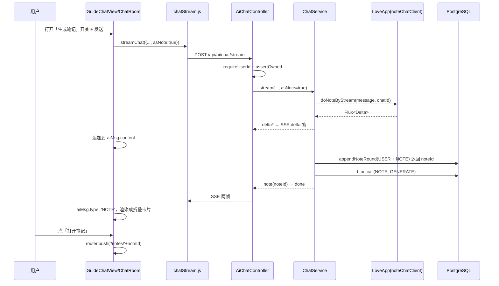
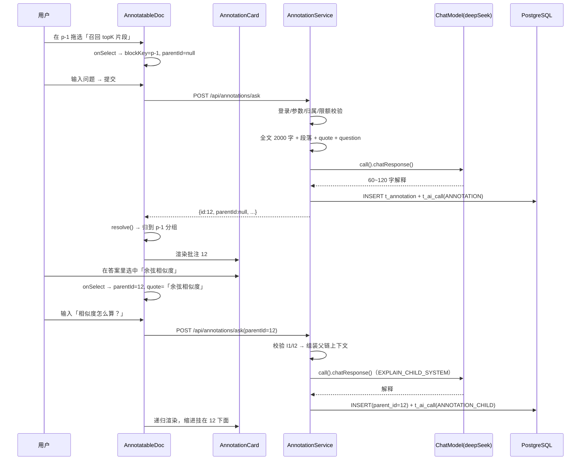

# V2 可批注笔记 · 软件设计文档（SDD）

> **Software Design Document** · v1.0 · 2026-11-14 · 状态：待实施
> 需求来源：`docs/v2-annotatable-note.md`（v0.4，范围与 non-goals 以该文为准，本文不重复）
> 本文只描述**怎么实现**：模块、数据、接口、流程、改动点、测试与实施顺序。
> 技术基线来自对现有代码的实测调研，路径均为工作区内真实文件。

---

## 1. 文档控制

| 项 | 内容 |
|---|---|
| 文档类型 | 软件设计说明书（概要设计 + 详细设计合编） |
| 关联需求 | `docs/v2-annotatable-note.md` v0.4 |
| 读者 | 实施者本人（单人开发，无评审流程） |
| 术语 | **正文**：笔记 markdown 或章节 markdown；**块**：markdown 顶层块（`p-0`、`p-1`）；**顶层批注**：锚定正文的批注；**子批注**：锚定某条批注答案的批注；**引用快照 `quote`**：选中文字的原文副本 |
| 变更方式 | 实施中发现与本文不符，先改本文再改代码 |

---

## 2. 设计目标与技术基线

### 2.1 目标

在现有 Spring Boot + Vue 单体上增量实现「笔记生成 + 正文编辑 + 右侧批注栏 + 子批注链」，**不改现有聊天/出题/判分链路的行为**，两个切片可独立停、独立演示。

### 2.2 技术基线（实测）

| 层 | 事实 |
|---|---|
| 后端 | Java 21、Spring Boot 3.4.4、Spring AI 1.1.0、PostgreSQL 16 |
| 数据访问 | `JdbcTemplate`，事务边界在 Service；无 JPA / MyBatis / Flyway / Liquibase |
| 鉴权 | Servlet `HttpSession`，`CurrentUserResolver.requireUserId(HttpServletRequest)` 返回 `UUID`；session key `userId` |
| 异常 | `BadRequestException` / `UnauthorizedException` / `ForbiddenException` → `GlobalExceptionHandler` 统一 `{"message": "..."}`，400 / 401 / 403；**无 Result 包装类** |
| 模型 | 业务代码按参数名注入 `ChatModel deepSeekChatModel`（多模型 bean，Spring 按名匹配）；`AiCallRecorder` 统一埋点 |
| 服务 | `server.port=8123`，`context-path=/api`；SSE 超时硬编码 `new SseEmitter(180000L)` |
| 前端 | Vue 3.5.12 `<script setup>` + `<style scoped>`、Vite 5.4.10、vue-router 4.4.5、axios 1.7.7、`marked` 18.1.1 + `DOMPurify` 3.4.17；无 Pinia、无 UI 库、原生 CSS 变量 |
| 请求 | `api/request.js`：`baseURL '/api'`、`withCredentials: true`、响应拦截器脱壳；SSE 走 `api/chatStream.js` 的原生 `fetch` |
| 前端代理 | Vite `5173` → `/api` → `http://localhost:8123` |

### 2.3 全局约束

1. **不引入任何新依赖**（后端、前端均不加库）。
2. **不新建 `ChatModel` bean、不引入用户级 API Key**；所有 AI 调用复用 `deepSeekChatModel` 与服务端默认配置。
3. `db/schema.sql` 是「空库一次性建全」脚本，**不改**；本次改结构交付独立 `db/migration-v2.sql`，手工执行。
4. 新建 Controller 一律遵循 `requireUserId(request)` → `assertOwned(...)` → 业务 的顺序。
5. 新增前端路由必须挂在 `AppShell` 父路由下并带 `meta: { requiresAuth: true }`。
6. 批注的 `answer` 用 Vue `{{ }}` 插值渲染，**不走 `v-html`**；正文继续走 `renderMarkdown`（DOMPurify 已配置）。

---

## 3. 总体设计

### 3.1 分层与模块

```
浏览器
  ├─ GuideChatView / ChatRoom   ← 生成笔记开关 + NOTE 卡片
  ├─ NoteDetailView             ← 笔记全文 + 编辑（新页）
  └─ SectionReadView            ← 章节只读正文
        │  共用
        ▼
  AnnotatableDoc.vue            ← 两栏布局 / 块切分 / 选区 / 编辑预览 / 分组
        │
        ▼
  AnnotationCard.vue            ← 递归批注卡片 / 卡内选区 / 编辑删除
        │  axios (request.js)          SSE (chatStream.js)
        ▼                             ▼
  NoteController  AnnotationController   AiChatController
        │                │                    │
  NoteService      AnnotationService    ChatService → LoveApp
        │                │                    │
  MessageRepository AnnotationRepository  MessageService / AiCallRecorder
        │                │
        └──── JdbcTemplate ────► PostgreSQL
```

### 3.2 两个数据源、一套抽象

| | 笔记（NOTE） | 章节（SECTION） |
|---|---|---|
| 正文来源 | `t_message.content`，`type='NOTE'` | `t_knowledge_item.content` |
| `targetId` 类型 | `BIGINT` → 字符串 | `UUID` → 字符串 |
| `bodyEditable` | `true` | `false` |
| 归属校验路径 | `t_message → t_conversation.user_id` | `t_knowledge_item.user_id` |
| 批注能力 | 完全相同 | 完全相同 |

`target_id` 用 `VARCHAR(64)` 存两类 ID，**数据库层无法建外键**，归属校验必须在应用层（见 6.5）。

### 3.3 关键设计决策（只记结论，理由见需求文档）

| # | 决策 |
|---|---|
| D1 | 笔记 = `t_message` 里一条 `type='NOTE'` 的 ASSISTANT 消息，不建 `t_note` |
| D2 | 批注独立表 `t_annotation`，不写进 `t_message`（避免污染 ChatMemory 与「做成题」的材料） |
| D3 | 锚点 = 段落 `blockKey` + `quote` 快照；不做字符偏移、不引入块编辑器 |
| D4 | 子批注用 `parent_id` 自引用一列实现，不另建表、不用递归 SQL 取树 |
| D5 | 批注在右侧独立栏，按 `blockKey` 分组排序；不做与正文行的像素级对齐 |
| D6 | 解释 60~120 字、单段、非流式；子批注提问携带父链上下文 |
| D7 | 所有模型调用走默认 `ChatModel`，观测走 `AiCallRecorder` |

### 3.4 现状约束：动手前必须同步修改的点（重要）

调研发现以下既有实现会**直接挡住** V2，需求文档未覆盖，实施时逐项处理：

| # | 现状 | 必须做的改动 |
|---|---|---|
| C1 | `model/MessageRow.java` 只有 `messageId/role/content/createdAt`；`MessageRepository.findAllByConversation` 的 SQL 不 SELECT `type` | **`MessageRow` 加 `type` 字段，SQL 加 `m.type`**；否则历史消息里根本认不出 NOTE，卡片渲染无从谈起 |
| C2 | `MessageService.appendRound(...)` 写死 `QUESTION` / `ANSWER`，且 `MessageRepository.insert` 不返回 id | 新增 `appendNoteRound(...)` 返回 `long`，ASSISTANT 行用 `NOTE`，靠 `insertReturningId` 拿 id 供 SSE `note` 帧使用 |
| C3 | `model/MessageType.java` 枚举只有 4 个值 | 加 `NOTE` |
| C4 | `model/ChatEvent.java` sealed 接口只有 `Delta/Sources/Tool/Done/Error` | 加 `record Note(long noteId)`，事件名 `note` |
| C5 | `AiChatController.StreamRequest` 只有 4 个字段；`ChatService.stream` 是 5 参 | 请求体加 `Boolean asNote`；`stream(...)` 加第 6 个 boolean；`LoveApp` 加笔记提示词分支 |
| C6 | `t_ai_call.scene` 有 CHECK 只允许 6 个值 | **新增 3 个 scene 必须同步 `ALTER ... DROP/ADD CONSTRAINT`**，否则 `recordCall` 抛 `23514` |
| C7 | `t_message` 没有 `updated_at` | 加列，笔记编辑时更新；否则详情页无法显示保存时间 |
| C8 | `SectionReadView` 用 `contentHtml = renderMarkdown(整篇)` + 单个 `v-html` | **整篇 HTML 无法按段落定位**。必须改成按顶层块切分、逐块渲染并包 `data-block-key`（见 7.2）。这是前端最大改动 |
| C9 | `SectionReadView` 当前是单栏 `.reader-inner{max-width:720px}` + 吸底 `.action-bar` | 两栏布局需调整容器宽度；吸底操作栏保留不动 |
| C10 | 阅读页**没有**选中高亮样式（v0.3 文档曾写「已有选中遮罩可复用」，属误判） | 新增 `.quote-hit` / `.block-has-annotation` 等局部样式 |
| C11 | `api/chatStream.js` 的请求体写死 4 个字段；事件分发在 `ChatRoom.vue` 的 `onEvent` | 加 `asNote` 透传；`note` 帧在 `onEvent` 里转成 NOTE 卡片数据 |
| C12 | `db/` 下只有 `schema.sql`，无 migration 文件、无 Flyway | 交付 `db/migration-v2.sql`，用 `psql -f` 手工执行；在 README/impl-log 记执行记录 |

### 3.5 相对需求文档的实现调整（外部行为不变）

| 调整 | 理由 |
|---|---|
| `GET /annotations` **返回扁平列表**（按 `created_at` 排序），由前端按 `blockKey` 分组 + `parentId` 组树 + 计算 `stale` | `stale` 本来就要前端按 `quote` 匹配计算，后端组树是重复劳动；一次查询、零递归 SQL |
| 跨段落选区（anchor 与 focus 不在同一 `blockKey`）**直接忽略**并提示「请只选一段内的文字」 | 对应 non-goal「不做跨段落选区」，避免为罕见场景引入 Range 合并逻辑 |
| `quote` 字符级高亮做 **best-effort**：匹配不到（被 markdown 标记切开）时降级为「该段落左侧色条 + 批注数角标」 | 保证批注永远可读，不因渲染细节失败 |
| 笔记生成复用同一 `ChatMemory`（同 `chatId`），不另建记忆实例 | 需求已定；已知副作用见第 13 节 R1 |

以上均不改外部行为。需求文档第 3 节接口表中 `GET /annotations`「按段落分组、按 parentId 组树」一句，以本文 5.5 的扁平列表为准（需求文档保持精简版不动）。

---

## 4. 数据设计

### 4.1 表关系

```
t_user ──< t_conversation ──< t_message(type=NOTE) ──< t_annotation(target_type='NOTE')
  │                                                        │
  └──< t_knowledge_item ────────────< t_annotation(target_type='SECTION')
                                             │
                                             └─ parent_id 自引用（子批注链）
t_ai_call ← 所有模型调用（scene 扩展 3 个值）
```

`t_annotation.target_id` 与 `t_message` / `t_knowledge_item` **无数据库外键**，靠应用层校验（6.5）。

### 4.2 迁移脚本 `db/migration-v2.sql`（全文）

```sql
-- V2 可批注笔记迁移。手工执行：psql -d ai_agent_study -f db/migration-v2.sql
-- 前置：db/schema.sql 已在空库执行过（PG16）。
-- 说明：schema.sql 里的 CHECK 是列级内联约束，PG 自动命名为
--       t_message_type_check / t_ai_call_scene_check，故可直接 DROP。
BEGIN;

-- 1) 消息类型增加 NOTE
ALTER TABLE t_message DROP CONSTRAINT IF EXISTS t_message_type_check;
ALTER TABLE t_message ADD CONSTRAINT t_message_type_check
    CHECK (type IN ('QUESTION','ANSWER','FEEDBACK','CHAT','NOTE'));

-- 2) 笔记正文编辑需要更新时间
ALTER TABLE t_message
    ADD COLUMN IF NOT EXISTS updated_at TIMESTAMPTZ NOT NULL DEFAULT now();

-- 3) 观测场景扩展（不扩会让 recordCall 抛 23514）
ALTER TABLE t_ai_call DROP CONSTRAINT IF EXISTS t_ai_call_scene_check;
ALTER TABLE t_ai_call ADD CONSTRAINT t_ai_call_scene_check
    CHECK (scene IN ('CHAT','QUIZ_GENERATE','GRADE','HELP','SUMMARY','PRACTICE',
                     'NOTE_GENERATE','ANNOTATION','ANNOTATION_CHILD'));

-- 4) 唯一新增表
CREATE TABLE IF NOT EXISTS t_annotation (
    id          BIGINT       PRIMARY KEY GENERATED BY DEFAULT AS IDENTITY,
    user_id     UUID         NOT NULL REFERENCES t_user(id),
    target_type VARCHAR(10)  NOT NULL CHECK (target_type IN ('SECTION','NOTE')),
    target_id   VARCHAR(64)  NOT NULL,   -- SECTION: UUID 字符串 / NOTE: BIGINT 字符串
    parent_id   BIGINT       NULL REFERENCES t_annotation(id) ON DELETE CASCADE,
    block_key   VARCHAR(32)  NOT NULL,   -- 顶层=选中段落；子批注继承父的 block_key
    quote       TEXT         NOT NULL,   -- 顶层=正文选段；子批注=父答案里选中的词
    question    TEXT         NOT NULL,
    answer      TEXT         NOT NULL,
    edited      BOOLEAN      NOT NULL DEFAULT false,
    created_at  TIMESTAMPTZ  NOT NULL DEFAULT now()
);

CREATE INDEX IF NOT EXISTS idx_annotation_target
    ON t_annotation(user_id, target_type, target_id, block_key, created_at);
CREATE INDEX IF NOT EXISTS idx_annotation_parent
    ON t_annotation(parent_id);

COMMIT;
```

**回滚**（仅在未写入业务数据前使用）：

```sql
BEGIN;
DROP TABLE IF EXISTS t_annotation;
ALTER TABLE t_ai_call DROP CONSTRAINT IF EXISTS t_ai_call_scene_check;
ALTER TABLE t_ai_call ADD CONSTRAINT t_ai_call_scene_check
    CHECK (scene IN ('CHAT','QUIZ_GENERATE','GRADE','HELP','SUMMARY','PRACTICE'));
ALTER TABLE t_message DROP COLUMN IF EXISTS updated_at;
ALTER TABLE t_message DROP CONSTRAINT IF EXISTS t_message_type_check;
ALTER TABLE t_message ADD CONSTRAINT t_message_type_check
    CHECK (type IN ('QUESTION','ANSWER','FEEDBACK','CHAT'));
COMMIT;
```

### 4.3 字段语义与不变量

| 字段 | 语义 / 约束 |
|---|---|
| `parent_id` | `NULL` = 顶层批注；非 `NULL` = 子批注，指向父批注 id |
| `block_key` | 顶层为选区起点所在段落 key；子批注必须**继承父的 `block_key`**（用于分组，无独立定位意义） |
| `quote` | 不可改。顶层 ≤300 字且在正文内；子批注为父 `answer` 里的词 |
| `answer` | 唯一可编辑字段；AI 生成 60~120 字，用户可改写任意长度（上限 2000 字） |
| `edited` | `PATCH` 后置 `true`，不记版本 |

**不变量**（应用层保证，数据库不建触发器）：

- I1：`parent_id` 非空时，父必须存在、`user_id` 与子相同、`target_type`/`target_id` 与子相同。
- I2：链深（含自身）≤ 8。
- I3：单个 `(target_type, target_id)` 下批注总数（含子批注）≤ 200。
- I4：删除父批注时由 `ON DELETE CASCADE` 删除全部后代，不留孤儿。

### 4.4 归属校验 SQL

```sql
-- SECTION
SELECT EXISTS (SELECT 1 FROM t_knowledge_item WHERE id = ? AND user_id = ?);

-- NOTE（跨两层）
SELECT EXISTS (
    SELECT 1 FROM t_message m
      JOIN t_conversation c ON c.id = m.conversation_id
     WHERE m.id = ? AND m.type = 'NOTE' AND c.user_id = ?
);

-- 批注本身
SELECT EXISTS (SELECT 1 FROM t_annotation WHERE id = ? AND user_id = ?);

-- 父批注合法性（I1 一次查完）
SELECT id, user_id, target_type, target_id, block_key
  FROM t_annotation WHERE id = ?;

-- 链深（I2，从待插节点的父往上数）
WITH RECURSIVE chain AS (
    SELECT id, parent_id, 1 AS depth FROM t_annotation WHERE id = ?
    UNION ALL
    SELECT a.id, a.parent_id, c.depth + 1
      FROM t_annotation a JOIN chain c ON a.id = c.parent_id
)
SELECT COALESCE(MAX(depth), 0) FROM chain;

-- 后代数量（DELETE 返回用）
WITH RECURSIVE tree AS (
    SELECT id, parent_id FROM t_annotation WHERE id = ?
    UNION ALL
    SELECT a.id, a.parent_id
      FROM t_annotation a JOIN tree t ON a.parent_id = t.id
)
SELECT COUNT(*) FROM tree;
```

---

## 5. 接口设计

### 5.1 通用约定

- 全部前缀 `/api`（由 `context-path` 提供），Cookie 带 `JSESSIONID`（`withCredentials: true`）。
- 成功直接返回裸对象 / 数组 / `Map`，**不包 `code/data`**。
- 失败由 `GlobalExceptionHandler` 返回 `{"message": "..."}`：

| 状态 | 触发 |
|---|---|
| 400 | 参数校验失败、非法枚举、ID 解析失败、限额/链深超限、非法 `parentId`、目标不是 NOTE |
| 401 | 未登录（`requireUserId`） |
| 403 | 归属校验失败 |
| 500 | 模型调用失败（转成 `BadRequestException` 或独立 502，前端统一按 `message` 展示） |

### 5.2 `POST /api/ai/chat/stream`（改造）

请求体在 `StreamRequest` 上加一个字段：

```java
public record StreamRequest(
    @NotNull(message = "conversationId 不能为空") UUID conversationId,
    @NotBlank(message = "message 不能为空") @Size(max = 4000) String message,
    Boolean useRag,
    Boolean useTools,
    Boolean asNote            // 新增，null 视为 false
) {}
```

SSE 新增一帧（`ChatEvent` 加 record）：

```java
record Note(long noteId) implements ChatEvent {
    @Override public String type() { return "note"; }
}
```

帧序（仅 `asNote=true`）：`sources? → delta* → tool* → note → done`。`note` 必须在 `done` 之前，前端靠它把刚生成的消息渲染成卡片。

### 5.3 `GET /api/notes/{messageId}`（新增）

响应：

```json
{ "messageId": 128, "conversationId": "…uuid…", "type": "NOTE",
  "content": "# 什么是 RAG\n\n## 一、…", "createdAt": "…", "updatedAt": "…" }
```

校验：`requireUserId` → `SELECT m.* JOIN t_conversation` → 非本人 403 → `type != 'NOTE'` 400。

### 5.4 `PUT /api/notes/{messageId}`（新增）

请求 `{"content": "…markdown…"}`（≤ 20000 字）；响应 `{"messageId":128,"updatedAt":"…"}`。

```sql
UPDATE t_message SET content = ?, updated_at = now()
 WHERE id = ? AND type = 'NOTE';
```

先做 5.3 的归属校验再 update。**不重算后端锚点**（`blockKey` / `quote` 存在批注里，重定位由前端加载时计算，见 7.2）。

### 5.5 `GET /api/annotations`（新增）

Query：`targetType=SECTION|NOTE`、`targetId=...`。响应为**扁平数组**（按 `created_at` 升序）：

```json
[
  { "id": 12, "parentId": null, "blockKey": "p-1", "quote": "召回 topK 片段",
    "question": "topK 是什么？", "answer": "…", "edited": false, "createdAt": "…" },
  { "id": 13, "parentId": 12, "blockKey": "p-1", "quote": "余弦相似度",
    "question": "相似度怎么算？", "answer": "…", "edited": false, "createdAt": "…" }
]
```

前端按 `blockKey` 分组、按 `parentId` 组树、计算 `stale`（7.2）。

### 5.6 `POST /api/annotations/ask`（新增）

```java
public record AskRequest(
    @NotNull TargetType targetType,          // enum SECTION / NOTE，非法值自动 400
    @NotBlank @Size(max = 64)  String targetId,
    @NotBlank @Size(max = 32)  String blockKey,
    @NotBlank @Size(max = 300) String quote,
    @NotBlank @Size(max = 500) String question,
    Long parentId                            // 可空
) {}
```

响应：新建批注对象（同 5.5 的单条形状）。

**处理顺序**（不在事务里调模型，避免长事务占连接）：

1. `requireUserId` → 参数校验（Bean Validation）。
2. `targetId` 解析：SECTION 用 `UUID.fromString`、NOTE 用 `Long.parseLong`，失败 → 400。
3. 归属校验（4.4）→ 403。
4. `parentId != null`：查父，校验 I1，查链深 I2；任一不满足 → 400 / 403。
5. 查该目标下批注总数，≥200 → 400。
6. 组装上下文与提示词（6.3），`AiCallRecorder.start()` → `ChatClient.prompt().user(...).call().chatResponse()` → `recordCall(...)`；异常走 `recordFailure(...)` 后抛 500。
7. 截断答案到 200 字兜底 → `INSERT` → 返回对象。

### 5.7 `PATCH /api/annotations/{id}`（新增）

请求 `{"answer": "…"}`（≤2000 字，只接受该字段）；`UPDATE t_annotation SET answer=?, edited=true WHERE id=?`，先校验归属。响应更新后的对象。

### 5.8 `DELETE /api/annotations/{id}`（新增）

先校验归属 → 用 4.4 的递归 CTE 查后代数量 → `DELETE FROM t_annotation WHERE id = ?`（级联由 FK 完成）→ 响应 `{"id":12,"deletedCount":3}`（`deletedCount` 含自身，仅用于删除后的结果提示与日志）。删除前的确认数量 N 由前端用 `GET /annotations` 已组好的树计算：**算出 N → 弹确认「将同时删除 N 条追问」→ 确认后调 DELETE**，不需要额外的预检接口。

---

## 6. 后端详细设计

### 6.1 新增 / 修改类清单

| 类 | 类型 | 职责 |
|---|---|---|
| `AnnotationRepository` | 新增 | `insert / findByTarget / findById / belongsTo / countByTarget / depthOf / countDescendants / updateAnswer / deleteById` |
| `AnnotationService` | 新增 | 校验链、上下文组装、模型调用、埋点、落库 |
| `AnnotationController` | 新增 | 4 个接口（5.5~5.8） |
| `NoteService` | 新增 | 笔记读取 / 保存 / 归属校验 |
| `NoteController` | 新增 | 2 个接口（5.3~5.4） |
| `model/AnnotationRow.java` | 新增 | `record (long id, Long parentId, String blockKey, String quote, String question, String answer, boolean edited, OffsetDateTime createdAt)` |
| `model/TargetType.java` | 新增 | `enum { SECTION, NOTE }` |
| `model/MessageType.java` | 改 | 加 `NOTE` |
| `model/MessageRow.java` | 改 | 加 `String type`（C1） |
| `model/ChatEvent.java` | 改 | 加 `record Note(long noteId)`（C4） |
| `repository/MessageRepository.java` | 改 | `findAllByConversation` SELECT 加 `type`；新增 `findNoteById` / `updateContent` / `belongsToUser` |
| `service/MessageService.java` | 改 | 新增 `appendNoteRound(...)` 返回 `long`（C2） |
| `service/ChatService.java` | 改 | `stream(...)` 加 `boolean asNote`；按分支选提示词、落库方法、观测 scene，并在 `concatWith` 内先发 `note` 再发 `done` |
| `app/LoveApp.java` | 改 | 构造器内多建一个 `noteChatClient`（同 `deepSeekChatModel`，`defaultSystem(NOTE_PROMPT)`，挂同一 `ChatMemory` advisor）；新增 `doNoteByStream(...)` |
| `controller/AiChatController.java` | 改 | `StreamRequest` 加 `asNote`，传给 `chatService.stream(...)` |

**其余 Service 一行不动。**

### 6.2 笔记生成链路（精确到方法）

```java
// AiChatController.stream 内
chatService.stream(conversationId, req.message(), userId,
                   Boolean.TRUE.equals(req.useRag()),
                   Boolean.TRUE.equals(req.useTools()),
                   Boolean.TRUE.equals(req.asNote()));   // 新增

// ChatService.stream 内（保留 Flux 装配语义，不加 @Transactional）
Flux<ChatEvent> content = asNote
        ? loveApp.doNoteByStream(message, conversationId.toString())
        : loveApp.doChatByStream(message, conversationId.toString(), userId, useRag, useTools);

return content
    .doOnNext(ev -> { if (ev instanceof ChatEvent.Delta d) full.append(d.text()); })
    .publishOn(Schedulers.boundedElastic())
    .concatWith(Flux.defer(() -> {
        if (asNote) {
            long noteId = messageService.appendNoteRound(conversationId, message, full.toString());
            aiCallRecorder.recordStream(userId, "NOTE_GENERATE", startedAt, firstTokenAt.get(), true, null);
            return Flux.<ChatEvent>just(new ChatEvent.Note(noteId), new ChatEvent.Done());
        }
        messageService.appendRound(conversationId, message, full.toString());
        aiCallRecorder.recordStream(userId, "CHAT", startedAt, firstTokenAt.get(), true, null);
        return Flux.just(new ChatEvent.Done());
    }))
    .doOnError(e -> aiCallRecorder.recordStream(userId,
        asNote ? "NOTE_GENERATE" : "CHAT", startedAt, firstTokenAt.get(), false,
        e.getClass().getSimpleName()));
```

```java
// MessageService.appendNoteRound：一个事务内插两条并返回 ASSISTANT 行 id
@Transactional
public long appendNoteRound(UUID conversationId, String userText, String noteText) {
    messageRepository.insert(conversationId, MessageRole.USER.name(),
                             MessageType.QUESTION.name(), userText);
    long noteId = messageRepository.insertReturningId(conversationId,
        MessageRole.ASSISTANT.name(), MessageType.NOTE.name(), noteText);
    conversationRepository.touch(conversationId);
    return noteId;
}
```

`LoveApp.doNoteByStream` 与 `doChatByStream` 同构，但**不挂工具、不挂 RAG**（笔记是一次性成篇，不需要检索与工具循环），只挂 `MessageChatMemoryAdvisor` + `MyLoggerAdvisor`：

```java
public Flux<ChatEvent> doNoteByStream(String message, String chatId) {
    return noteChatClient.prompt()
            .user(message)
            .advisors(a -> a.param(ChatMemory.CONVERSATION_ID, chatId))
            .stream().content()
            .map(ChatEvent::delta);
}
```

### 6.3 `AnnotationService` 与提示词

```java
@Service
@RequiredArgsConstructor
public class AnnotationService {
    private final ChatModel deepSeekChatModel;   // 参数名不可改，按名匹配 bean
    private final AnnotationRepository repo;
    private final KnowledgeItemRepository knowledgeItemRepository;
    private final MessageRepository messageRepository;
    private final AiCallRecorder aiCallRecorder;

    public AnnotationRow ask(UUID userId, AskRequest req) { /* 5.6 的 7 步 */ }
    private String buildContext(AskRequest req, AnnotationRow parent, List<String> chain) { ... }
    private String buildUserMessage(AskRequest req, String context) { ... }
    private String call(String system, String userMessage, UUID userId, String scene) { ... }
}
```

**三个提示词常量**（附录 A 给出全文）：`NOTE_PROMPT`（笔记生成）、`EXPLAIN_SYSTEM`（顶层）、`EXPLAIN_CHILD_SYSTEM`（子批注）。共用的输出约束：

```
一段话，60~120 字，中文。不分点、不列清单、不加标题、不复述问题、不使用 Markdown 列表。
只解释该词/该句在「给定语境」中的意思，不要写成百科词条。不确定就直说不确定。
```

**上下文组装**：

| 场景 | 用户消息内容 |
|---|---|
| 顶层批注 | `【全文（截断 2000 字）】…` + `【所在段落】…`（按 `blockKey` 取不到就退化为全文前 2000 字）+ `【选中片段】quote` + `【问题】question` |
| 子批注 | `【正文原句】顶层祖先.quote` + `【前文解释】祖先链答案（最多 3 层，由父到子）` + `【父批注答案】parent.answer` + `【本次选中的词】quote` + `【问题】question` |

全文从 `NoteService` / `KnowledgeItemRepository.findById` 取，**不做 RAG**（讲义 1000~3000 字，直接塞）。

**埋点**：

```java
long startedAt = aiCallRecorder.start();
ChatResponse response;
try {
    response = client.prompt().user(userMessage).call().chatResponse();
} catch (RuntimeException e) {
    aiCallRecorder.recordFailure(userId, scene, startedAt, e);
    throw new BadRequestException("解释生成失败，请稍后重试");
}
aiCallRecorder.recordCall(userId, scene, startedAt, response);
// scene = parentId == null ? "ANNOTATION" : "ANNOTATION_CHILD"
```

`client` 用方法内构造：`ChatClient.builder(deepSeekChatModel).defaultSystem(system).build()`（与 `HelpService` / `QuizService` 同一写法，避免污染 `LoveApp` 的单例提示词）。

### 6.4 归属校验（越权防护）

```java
private void assertTargetOwned(UUID userId, TargetType type, String targetId) {
    boolean ok = switch (type) {
        case SECTION -> {
            UUID id;
            try { id = UUID.fromString(targetId); }
            catch (IllegalArgumentException e) { throw new BadRequestException("targetId 不合法"); }
            yield knowledgeItemRepository.belongsTo(id, userId);
        }
        case NOTE -> {
            long id;
            try { id = Long.parseLong(targetId); }
            catch (NumberFormatException e) { throw new BadRequestException("targetId 不合法"); }
            yield messageRepository.noteBelongsToUser(id, userId);   // 见 4.4 JOIN SQL
        }
    };
    if (!ok) throw new ForbiddenException("无权访问该内容");
}
```

`PATCH` / `DELETE` 用 `repo.belongsTo(id, userId)`；`parentId` 额外校验「父的 `user_id` = 当前用户」且「父的 `target_type`/`target_id` = 本次请求」，防止把别人的批注挂成自己的父节点。

### 6.5 事务边界

| 操作 | 事务 |
|---|---|
| `appendNoteRound` | `@Transactional`（两条消息 + touch 同一事务） |
| `ask` | **不标 `@Transactional`**：模型调用是远程 IO；校验、模型调用、单条 INSERT 各自独立，失败时不留半条数据 |
| `updateAnswer` / `deleteById` | 单条 SQL，无需显式事务（DELETE 的级联由 FK 保证原子性） |
| `ChatService.stream` | 保持现状，**不能标** `@Transactional`（Flux 是装配说明） |

---

## 7. 前端详细设计

### 7.1 组件与文件清单

| 文件 | 类型 | 职责 |
|---|---|---|
| `components/AnnotatableDoc.vue` | 新增 | 两栏布局、块切分、选区捕获、编辑/预览两态、批注分组与 stale 计算、接口编排 |
| `components/AnnotationCard.vue` | 新增 | 递归卡片（引用/问/答/编辑/删除/卡内选区），按 `depth` 缩进 |
| `views/NoteDetailView.vue` | 新增 | 取笔记、编辑保存、挂 `AnnotatableDoc(:bodyEditable="true")` |
| `api/notes.js` / `api/annotations.js` | 新增 | 基于 `request.js` 的薄封装 |
| `components/ChatRoom.vue` | 改 | `onEvent` 加 `note` 分支；消息 `v-for` 按 `m.type==='NOTE'` 渲染卡片；`addMessage` 加 `type` 字段 |
| `views/GuideChatView.vue` | 改 | 加第 4 个开关 `asNote` ref，透传给 `ChatRoom`；`noteId` → 卡片数据 |
| `api/chatStream.js` | 改 | `streamChat` 参数加 `asNote = false`，body 加该字段；抽 `parseFrame` 保持不变 |
| `views/SectionReadView.vue` | 改 | `.prose` 换成 `AnnotatableDoc(:bodyEditable="false")`；保留 `.action-bar` 与翻页 |
| `utils/markdown.js` | 改 | 新增导出 `splitBlocks(md)`（7.2），`renderMarkdown` 保持不变 |
| `router/index.js` | 改 | `AppShell` 子路由加 `notes/:messageId` → `NoteDetailView`，`meta.requiresAuth: true` |

### 7.2 `AnnotatableDoc` 核心算法

**（1）块切分**——用 `marked.lexer` 取顶层 token，逐 token 渲染，避免 `\n\n` 硬切把代码块/列表切坏：

```js
// utils/markdown.js 追加
export function splitBlocks(md) {
  if (!md) return []
  return marked.lexer(md)
    .filter(t => t.type !== 'space')
    .map((t, i) => ({
      key: `p-${i}`,
      text: t.raw,
      html: DOMPurify.sanitize(marked.parser([t]))
    }))
}
```

渲染：

```html
<div class="doc-body" ref="bodyEl" @mouseup="onSelect">
  <div v-for="b in blocks" :key="b.key" :data-block-key="b.key"
       :class="{ 'block-has-annotation': groupOf(b.key).length }"
       v-html="highlighted(b)"></div>
</div>
```

`highlighted(b)` 做 best-effort quote 高亮：把 `escapeHtml(quote)` 在该块 HTML 里替换一次为 `<mark class="quote-hit">…</mark>`；匹配不到就返回原 HTML，靠 `.block-has-annotation` 左侧色条提示本段有批注。

**（2）选区捕获**：

```js
function onSelect() {
  const sel = window.getSelection()
  if (!sel || sel.isCollapsed) return
  const quote = sel.toString().trim()
  if (!quote || quote.length > 300) return

  const anchorEl = sel.anchorNode?.nodeType === 3
      ? sel.anchorNode.parentElement : sel.anchorNode
  if (!anchorEl?.closest) return

  const card = anchorEl.closest('[data-annotation-id]')     // 在批注卡片内 → 子批注
  if (card) {
    openAsk({ parentId: Number(card.dataset.annotationId), quote,
              blockKey: parentOf(card).blockKey })
    return
  }

  const block = anchorEl.closest('[data-block-key]')
  const focusBlock = (sel.focusNode?.nodeType === 3
      ? sel.focusNode.parentElement : sel.focusNode)?.closest?.('[data-block-key]')
  if (!block || !focusBlock || block !== focusBlock) {
    toast('请只选一段内的文字'); return                       // 跨段落选区不处理
  }
  openAsk({ parentId: null, quote, blockKey: block.dataset.blockKey })
}
```

`（3）锚点重定位与 stale 计算`（每次加载 / 保存正文后执行）：

```js
function resolve(blocks, flat) {
  const byId = new Map(flat.map(a => [a.id, { ...a, children: [], stale: false }]))
  for (const a of byId.values()) {
    if (a.parentId && byId.has(a.parentId)) byId.get(a.parentId).children.push(a)
    else if (a.parentId) a.parentId = null   // 父被删但数据残留：按顶层兜底，不丢内容
  }
  for (const a of byId.values()) {
    if (!a.parentId) {
      const hit = blocks.find(b => b.key === a.blockKey && b.text.includes(a.quote))
                  || blocks.find(b => b.text.includes(a.quote))
      a.stale = !hit
      a.groupKey = hit?.key ?? null
    } else {
      const p = byId.get(a.parentId)
      a.stale = !p || !p.answer.includes(a.quote)
      a.groupKey = p?.groupKey ?? null       // 跟随父分组
    }
  }
  return byId
}
```

`stale === true` 的项统一放进「原文已修改」分组，仍显示 `quote` / `question` / `answer`，只是不再贴着某段。`children` 按 `created_at` 升序，保证追问链顺序稳定。

**（4）两栏布局**：

```css
.doc-layout { display: grid; grid-template-columns: minmax(0, 1.5fr) minmax(280px, 1fr);
              gap: 24px; align-items: start; }
.doc-body { max-width: 720px; }
.note-rail { border-left: 1px solid var(--line); padding-left: 20px; }
@media (max-width: 1024px) {
  .doc-layout { grid-template-columns: 1fr; }
  .note-rail { border-left: none; border-top: 1px solid var(--line); padding: 16px 0 0; }
}
```

复用 `global.css` 的 `--bg/--surface/--ink/--ink-soft/--line/--accent`；`.btn`、`.tool-btn`、`.banner` 沿用现有语义类。阅读页原来的 `.action-bar`（`position: sticky; bottom: 0`）保持不变。

**（5）编辑/预览两态**：`bodyEditable=true` 时显示「编辑」按钮 → `editing=true` → 用 `<textarea v-model="draft">` 替换 `.doc-body`（整篇 markdown 原文）→ 「保存」调 `PUT /notes/{id}` → 成功后 `markdown = draft`、`editing=false`、重跑 `resolve()`。`bodyEditable=false` 完全不渲染该按钮与 textarea，其余逻辑一字不改。

### 7.3 `AnnotationCard` 递归

```html
<template>
  <div class="anno-card" :data-annotation-id="item.id"
       :style="{ marginLeft: Math.min(depth, 3) * 16 + 'px' }">
    <div class="anno-quote">{{ item.quote }}</div>
    <div class="anno-q">问：{{ item.question }}</div>
    <div v-if="!editing" class="anno-a">{{ item.answer }}</div>
    <textarea v-else v-model="draft" />
    <div class="anno-ops">
      <button @click="toggleEdit">{{ editing ? '保存' : '编辑' }}</button>
      <button @click="$emit('delete', item)">删除</button>
      <span v-if="item.edited">已编辑</span>
      <span v-if="item.stale">原文已修改</span>
      <span v-if="depth >= 3">↳ 第 {{ depth + 1 }} 层追问</span>
    </div>
  </div>
  <AnnotationCard v-for="c in item.children" :key="c.id" :item="c" :depth="depth + 1"
                   @edit @delete />
</template>
```

`answer` 用 `{{ }}` 插值，不走 `v-html`。卡内选区由父组件 `AnnotatableDoc` 的事件委托统一处理（选区可能跨卡片 DOM，`@mouseup` 挂在最外层 `.doc-layout`）。

### 7.4 聊天侧改动

- `chatStream.js`：`streamChat({ ..., asNote = false, ... })` → `body: JSON.stringify({ conversationId, message, useRag, useTools, asNote })`。
- `ChatRoom.vue`：`onEvent` 加分支
  ```js
  if (name === 'note') { aiMsg.type = 'NOTE'; aiMsg.noteId = payload?.noteId; return }
  ```
  消息模板加 `v-if="m.type === 'NOTE'"` 分支渲染卡片（`NOTE` 标签 + 首行标题 + `content` 前 80 字 + 「打开笔记 →」→ `router.push('/notes/' + m.noteId)`）；历史消息映射加 `type: m.type`（依赖 C1）。
- `GuideChatView.vue`：`const asNote = ref(false)`，第 4 个 `button.tool-btn`（`:class="{ on: asNote }"`），透传 `:as-note="asNote"` 给 ChatRoom；发送后重置为 `false`（一次只管一条消息）。

### 7.5 路由

```js
{ path: 'notes/:messageId', name: 'note-detail',
  component: () => import('../views/NoteDetailView.vue'),
  meta: { requiresAuth: true } }
```

挂在 `AppShell` 父路由的 `children` 内，与 `guide` / `materials` 平级。

---

## 8. 关键流程时序

### 8.1 生成笔记



### 8.2 顶层批注 → 子批注



### 8.3 编辑正文后的降级

1. `PUT /notes/{id}` 保存 → 前端 `markdown = draft`。
2. `splitBlocks(draft)` 重算 `p-N`。
3. `resolve(blocks, annotations)`：先按原 `blockKey` + `quote` 找；找不到则全文 `includes(quote)` 重定位；仍找不到 `stale=true`。
4. 子批注拿 `quote` 去父 `answer` 里找，父答案被改过则同样 `stale=true`。
5. `stale` 项进「原文已修改」分组，问答内容原样显示。

---

## 9. 安全设计

| 风险 | 措施 |
|---|---|
| 未登录访问 | 每个新接口首行 `currentUserResolver.requireUserId(request)` |
| 越权读/改他人笔记或批注 | 4.4 的 JOIN / `belongsTo` 校验，先校验再查询；`target_id` 是字符串，必须解析后比对 |
| 伪造 `parentId` 挂他人批注 | 校验父的 `user_id` 与 `target_type`/`target_id` 与本次一致（I1） |
| SQL 注入 | 全部 `JdbcTemplate` 占位符 `?`，无字符串拼接；递归 CTE 也用参数 |
| XSS | 正文走 `DOMPurify.sanitize`；批注 `answer`/`quote`/`question` 一律 `{{ }}` 插值；`highlighted()` 只对已 sanitize 的 HTML 做转义后精确替换，不插入用户输入原文 |
| 提示词注入（正文里写「忽略以上指令」） | 上下文用明确分隔标记包裹；输出约束写在 system；v0 不做更强的隔离 |
| 刷接口 | `quote` ≤300、`question` ≤500、单目标 ≤200 条、链深 ≤8、答案截断 200 字 |
| SSRF / 命令执行 | 本版不引入 URL 抓取、文件操作、终端工具（批注只用已有正文与内部表） |
| 密钥 | 不新增任何 key 存取路径，沿用 `application-local.yml` |

---

## 10. 异常与边界

| 场景 | 处理 |
|---|---|
| 目标不是 `type='NOTE'` 的消息 | 400「不是笔记」 |
| `targetId` 格式不合法 | 400「targetId 不合法」 |
| `parentId` 不存在 / 属于他人 / 目标不一致 | 400 或 403 |
| 链深 > 8 / 批注数 ≥ 200 | 400，不发起模型调用 |
| 模型超时 / 报错 | `recordFailure` 写 `t_ai_call` → 抛 `BadRequestException`，前端显示 `message` |
| 答案超 120 字 | 后端按 200 字硬截断兜底（不重试，避免双倍成本） |
| 跨段落选区 | 前端忽略并提示，不发请求 |
| `quote` 被 markdown 标记切开导致高亮失败 | 降级为段落色条 + 数量角标，批注不受影响 |
| 删除父批注 | 前端先按本地树算后代数量弹确认；DB 级联删除 |
| 并发重复提交 | 前端提交期间禁用按钮；后端不做幂等（黑客松范围） |
| SSE 中断 | 沿用现有 `error` 帧与 `ChatService.doOnError` 埋点；笔记未落库则无 `note` 帧，前端按普通回答收尾 |

---

## 11. 测试设计

**后端单元/集成**（沿用现有测试风格：`@SpringBootTest` + `@Transactional` 回滚）

| # | 用例 |
|---|---|
| T1 | `splitBlocks` 对含代码块 / 列表 / 表格的 markdown 不切坏（前端单测或手工） |
| T2 | `resolve()`：原段落命中 / 段落错位后 `quote` 重定位 / 找不到置 `stale` 三分支 |
| T3 | `POST /annotations/ask` 顶层与子批注各一条，落库字段正确，`parent_id` 继承 `block_key` |
| T4 | 伪造 `targetId` → 403；伪造他人 `parentId` → 403；链深 9 → 400 |
| T5 | `PATCH` 只改 `answer` 与 `edited`；传 `question` → 400 |
| T6 | 删除父 → 后代全删、无孤儿、`deletedCount` 正确 |
| T7 | `asNote=true` 的 SSE 帧序含 `note`（在 `done` 前），落库 ASSISTANT 行 `type='NOTE'` |
| T8 | 历史消息接口返回 `type` 字段，NOTE 行可被前端识别 |
| T9 | 新增 3 个 `scene` 均能写入 `t_ai_call`（验证 C6 的 ALTER 已执行） |
| T10 | 未执行 migration 时接口全部失败并有明确报错（防止漏跑脚本） |

**手工验收**（对齐需求文档两个切片）

| # | 操作 | 预期 |
|---|---|---|
| A1 | 阅读页选一句 → 提问 | 右栏出现一段 60~120 字解释，不新开对话 |
| A2 | 刷新 | 批注仍在原分组；改过正文则重定位，找不到显示「原文已修改」且内容不丢 |
| A3 | 在批注答案里选中「余弦相似度」→ 追问 | 生成缩进的子批注，答案用到父语境；刷新后层级不变 |
| A4 | 编辑父批注答案，把该词改掉 | 子批注显示「原文已修改」，内容保留 |
| A5 | 删除有 2 条追问的批注 | 提示 N 条，确认后 3 条一起消失 |
| A6 | 同一会话先普通问、再开「生成笔记」 | 前者仍是引导式，后者是笔记卡片，不刷屏 |
| A7 | 关闭开关 | 行为与改动前完全一致 |
| A8 | 编辑笔记正文并保存 | 刷新是新内容，旧批注仍可读 |
| A9 | 阅读页（`bodyEditable=false`） | 无编辑按钮，批注全功能可用 |
| A10 | 窗口 < 1024px | 右栏移到正文下方，不横向滚动 |
| A11 | B 用户访问 A 的笔记 / 批注 | 403 |

---

## 12. 实施计划

### 切片 1 · 批注内核（含右侧栏与子批注链）

按依赖顺序：

1. `db/migration-v2.sql` 落地并手工执行（含 C6/C7 两个 ALTER）；`db/schema.sql` 不动。
2. 新增 `TargetType`、`AnnotationRow`、`AnnotationRepository`（含 4.4 全部 SQL）。
3. 新增 `AnnotationService`（提示词见附录 A、校验链 5.6、埋点 6.3）+ `AnnotationController`（4 个接口）。
4. `utils/markdown.js` 加 `splitBlocks`；新增 `AnnotatableDoc.vue`、`AnnotationCard.vue`（7.2 / 7.3）。
5. 新增 `api/annotations.js`；`SectionReadView.vue` 接入，`:bodyEditable="false"`；调整 `.reader-inner` 容器适配两栏。
6. 跑 A1~A5、A9~A11 与 T2~T6。**此切片可独立演示。**

### 切片 2 · 笔记生成

1. 处理 C1~C5：`MessageType` / `MessageRow` / `MessageRepository` / `MessageService` / `ChatEvent` / `StreamRequest` / `ChatService` / `LoveApp`。
2. 新增 `NoteService` / `NoteController` / `api/notes.js` / `NoteDetailView.vue` / 路由。
3. `chatStream.js` 加 `asNote`；`ChatRoom.vue` 加 `note` 帧处理与 NOTE 卡片；`GuideChatView.vue` 加第 4 个开关。
4. 跑 A6~A8 与 T1、T7~T10。

**不动**：`schema.sql`、其余 6 个 Service、 `request.js` 拦截器、Vite 配置、`application.yml`、任何 Key 相关代码。

---

## 13. 风险与已知限制

| # | 风险 | 缓解 / 说明 |
|---|---|---|
| R1 | 笔记全文（1000~2000 字）会写进同一 `ChatMemory`，`BudgetedChatMemory` 预算 8000 字符可能挤掉历史上下文 | v0 接受；若明显影响下一轮，再在 `appendNoteRound` 后对记忆做截断，不在本版引入 |
| R2 | `marked.lexer` 顶层 token 的粒度不等于视觉段落（列表/表格整体算一个块） | 只影响分组粗细，不影响批注可读性；不做更细拆分 |
| R3 | `blockKey` 按索引 `p-N` 生成，正文增删段落会整体错位 | 由 `quote` 重定位兜底（8.3）；这是刻意的降级设计 |
| R4 | 非流式批注在弱网下按钮转圈较久 | 解释短、单段；体感不够再升 SSE（需复用 `ChatEvent`） |
| R5 | 无 Flyway，迁移可能漏跑 | T10 覆盖；执行记录写进 `docs/impl-log.md` |
| R6 | 编辑笔记正文后，同一 `conversationId` 的历史回放里 AI 回答与编辑后内容不一致 | 需求已接受「覆盖写、不保留版本」 |

---

## 附录 A · 提示词模板

**A1 `NOTE_PROMPT`（`LoveApp.noteChatClient` 的 `defaultSystem`）**

```
你是一位技术笔记撰写者。用户给出一个问题，你直接写成一篇结构完整的 Markdown 笔记。

要求：
- 结论前置，第一段就给出核心答案。
- 用 ## 划分 2~4 个小节，覆盖：是什么 / 为什么需要 / 大致流程或关键参数 / 常见误区。
- 1000~2000 字，可用代码块、表格、公式，但不要写成问答对话。
- 不要反问用户、不要引导用户自己思考、不要留「下一步你试试」这类话。
- 不确定的内容明确写「不确定」，不伪造文档、链接、版本号。
```

**A2 `EXPLAIN_SYSTEM`（顶层批注）**

```
你是嵌在笔记右侧的批注助手。用户选中了正文里的一句话并提了一个问题。

输出要求（必须严格遵守）：
- 一段话，60~120 字，中文。
- 不分点、不列清单、不加标题、不使用 Markdown 列表、不复述用户的问题。
- 只解释「选中片段」在「给定全文语境」里的意思，不要写成百科词条。
- 用最少的术语；必须出现术语时，顺带用半句话解释它。
- 不确定就说不确定，不编造事实。
```

**A3 `EXPLAIN_CHILD_SYSTEM`（子批注）**

```
你是嵌在笔记右侧的批注助手。用户正在读上一条批注的解释，又选中了其中一个陌生词继续追问。

输出要求（必须严格遵守）：
- 一段话，60~120 字，中文。
- 不分点、不列清单、不加标题、不使用 Markdown 列表、不复述用户的问题。
- 必须结合「正文原句」和「前文解释」的语境来解释这个词，不要泛泛给百科定义。
- 不要重复前文解释已经说过的内容。
- 不确定就说不确定。
```

**A4 用户消息模板**

```
# 顶层
【全文（前 2000 字）】
{fullTextTruncated}

【所在段落】
{blockText}

【选中片段】
{quote}

【问题】
{question}
```

```
# 子批注
【正文原句】
{rootQuote}

【前文解释】
{ancestorAnswers，最多 3 层，由父到子，用 --- 分隔}

【父批注答案】
{parentAnswer}

【本次选中的词】
{quote}

【问题】
{question}
```

---

## 附录 B · 与需求文档的对应关系

| 需求文档章节 | 本文章节 |
|---|---|
| 2.1 生成笔记 | 5.2、6.2、7.4、8.1 |
| 2.2 编辑笔记正文 | 5.3、5.4、7.2(5)、8.3 |
| 2.3 右侧批注栏与追问链 | 4、5.5~5.8、6.3、7.2、7.3、8.2 |
| 2.4 阅读页复用 | 7.1（`SectionReadView` 行）、7.2(5) |
| 3 落地清单 | 4.2、5、6.1、7.1 |
| 4 实施顺序 | 12 |
| 5 明确不做 | 2.3（约束）、9（安全）、13（限制），全文不重复列 non-goals |
